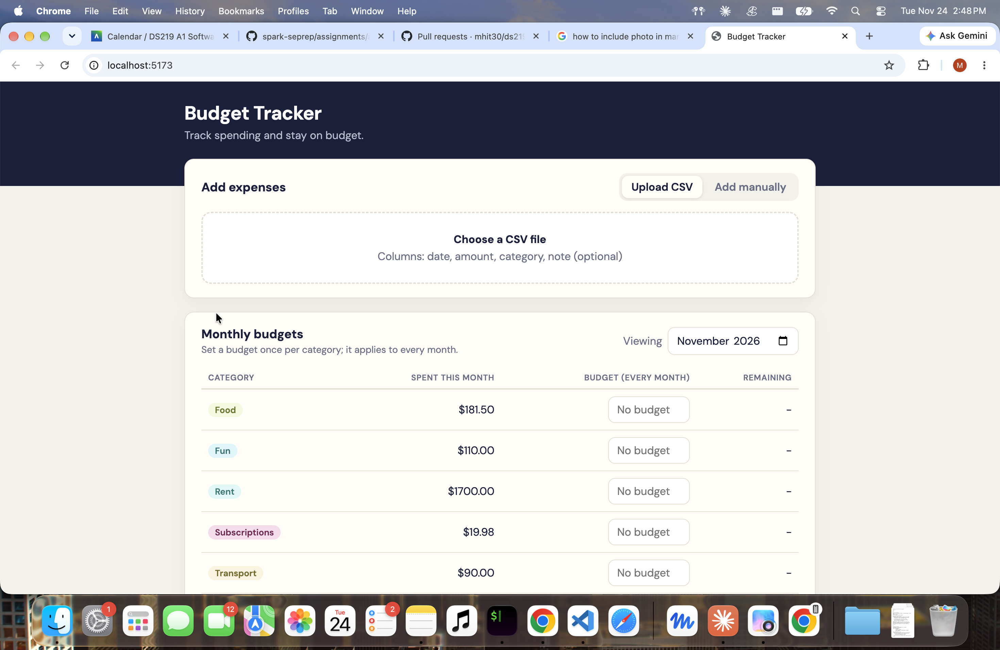

## Scope Sentence

My friends and I, wastes our time on budgeting and financial planning. The smallest version is one local React website that helps track expenses and maintains our budgets.

## Prerequisites 

The only prerequisite for this project is that you must have NodeJS installed. 

Here follow the instructions for installation [here](https://nodejs.org/en/download).

There are no environment variable requirements.

## Building / running the project 

### Without a container

```
git clone git@github.com:mhit30/ds219-final-project.git

cd ds219-final-project

npm install 

npm run start
```

### With container

```
docker build -f Containerfile -t my-app:latest .

docker run -p 5173:5173 my-app:latest
```

## How to use the application

The steps to use the application are straightforward.
1. Upload a CSV file with columns of date, amount, category, and an optional node. You may also manually add these values.
2. My program calculates the amount you spent and allows you to set a monthly budget for each category. It also displays how much you have left for the specific category this month. You may also add any additional categories to your liking.
3. The program gives you visual charts of your spending versus your budget per category, and also spending overall by the day. 
4. There is a raw spending table at the bottom of the page for full understanding of spending habits. 



## Additional settings or requirements

None